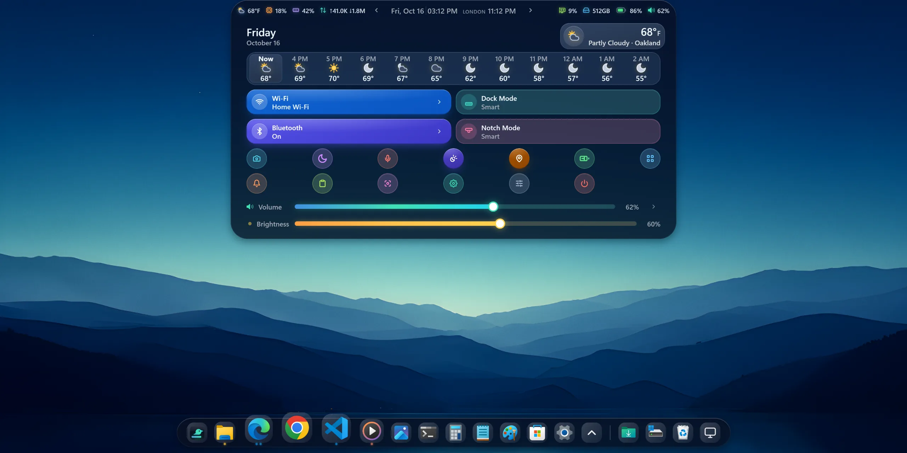
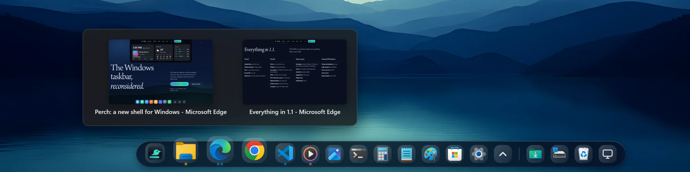
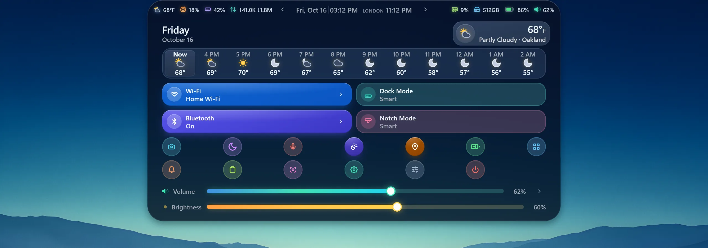
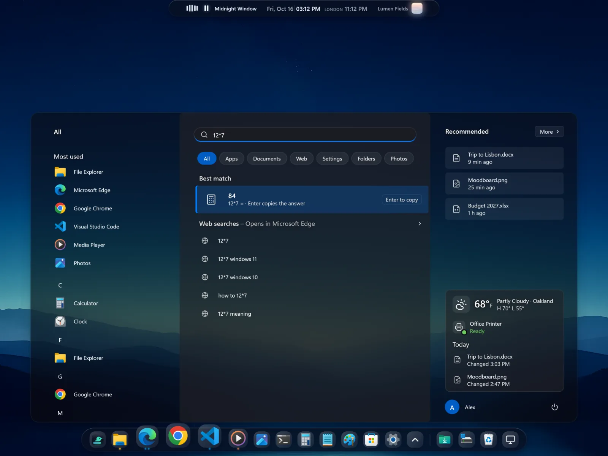

<!-- The pictures below live in docs/assets/shots/ (sizes and names: SLOTS.md there). -->

  <picture>
    <source media="(prefers-color-scheme: light)" srcset="docs/assets/shots/readme-hero-light.webp">
    
  </picture>

<h1 align="center">Perch</h1>

  A new shell for Windows: a dock in place of the taskbar, a live notch at the top of the screen, and a Start menu of its own. 
  Free. Version 1.1. Windows 11 and Windows 10 22H2.

  <a href="https://github.com/omanishay-cyber/perch/releases/latest"><b>Download the latest release</b></a>
  &nbsp;·&nbsp;
  <a href="https://omanishay-cyber.github.io/perch/">Website</a>
  &nbsp;·&nbsp;
  <a href="https://github.com/omanishay-cyber/perch/issues/new/choose">Report a bug</a>

---

## What Perch does

Perch sits on top of Windows and replaces the parts you look at all day. The taskbar becomes a dock. The empty
strip at the top of your screen becomes a notch that shows the time, the weather, your music and how your PC is
doing. The Start button opens Perch's own Start menu, in the style you like best.

Your apps, files and settings stay exactly where they are. Perch only changes how you reach them.

## The dock

- Icons grow under your cursor, so the one you are aiming at is always the biggest.
- Hover an open app to see live previews of its windows.
- Pin apps, folders and drives, with the Recycle Bin at the end.
- Over a full-screen game or video the dock stays hidden and shows up only when you press the Start key, the
  same rule the taskbar follows.

## The notch

A small black island at the top of the screen. Hover or click it and it opens.

- **Time**: the clock, a second time zone, the calendar, timers and a stopwatch.
- **Weather**: right now, plus an hour-by-hour forecast.
- **Music**: album art, play controls and a visualizer that moves with the song.
- **Your PC**: live CPU, RAM, GPU, disk, network, volume and battery.
- **Quick controls**: Wi-Fi, Bluetooth, sound output, notifications and the power menu.
- **Clipboard and notes**: your clipboard history and a quick note that saves itself.
- **12 notch designs** and two looks: Simple and Graphics.

## The Start menu

- Six designs: Modern, Windows 11, Windows 10 tiles, Down Aero, Windows 11X and Windows 7.
- Search finds apps, files and Settings pages, and works as a calculator (`12*7` gives 84) and a unit converter.
- Jump lists, pinned folders, a strip of widgets, and suggestions that change with the time of day.
- Everything works from the keyboard.

## Everything else

- Volume and brightness pop-ups that match the rest of Perch.
- Light and dark follow your Windows setting.
- Works on any screen size and DPI, and on touch screens.

## Supported Windows

| Windows | Supported |
|---|---|
| Windows 11 | Yes |
| Windows 10, version 22H2 | Yes |
| Older Windows 10 versions | No |

To check your version, press <kbd>Win</kbd> + <kbd>R</kbd>, type `winver` and press <kbd>Enter</kbd>.

## Install

1. Open the [latest release](https://github.com/omanishay-cyber/perch/releases/latest).
2. Under **Assets**, download `Perch-Setup.exe`.
3. Run it. If Windows SmartScreen shows "Windows protected your PC", click **More info**, then **Run anyway**.
4. Follow the installer's steps. Perch takes over the bottom and top of the screen when it starts.

To remove Perch, open **Settings > Apps > Installed apps**, find Perch and click **Uninstall**.

## How updates work

Each release here carries a small file called `latest.json`. Perch reads it to learn whether a newer version
exists, and offers you the update when one does. Every installer is signed, and Perch refuses an update whose
signature does not match.

## Report a bug or ask for a feature

Open a [new issue](https://github.com/omanishay-cyber/perch/issues/new/choose) and pick the form that fits. The
bug form asks for your Perch version, your Windows version and build, what happened and how to make it happen
again. A screenshot helps more than anything else.

## Licence

Perch is free to use, at home and at work. You may not copy, change, take apart, share, sell or republish it.
All rights are reserved by Anish Trivedi, and Perch comes with no warranty. The full text is in [LICENSE](LICENSE).

The source code is private. This repository holds the installers, the release notes, the update file, this page
and the licence.

---

Made by <a href="https://github.com/omanishay-cyber">Anish Trivedi</a>.

